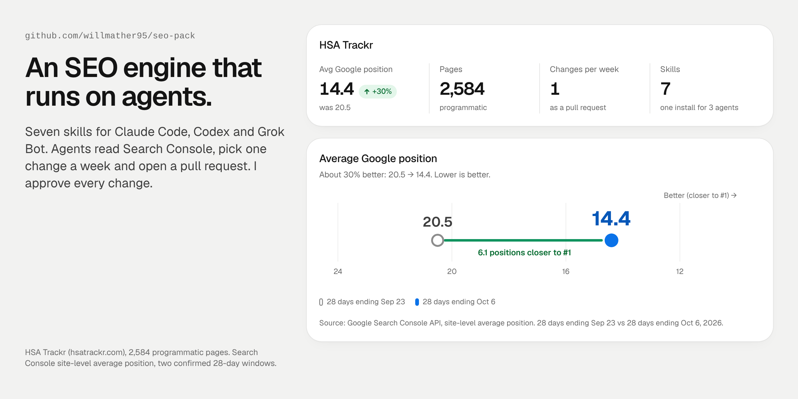

# seo-pack



Seven skills for SEO and AI-answer work, kept in one folder and installed the same way into Claude Code, Codex and Grok Bot.

I built this pack to run a weekly SEO loop on my own sites with AI agents doing most of the work. It has been the operating manual for that loop since October 2026. It is opinionated: one change per site per week, a receipt for every number, and nothing public ships without the owner's yes.

| Skill | What it does |
|---|---|
| `seo-loop` | The front door. Weekly mode reads the site file, pulls real data, picks one change, runs a four-pass check, waits for the owner's yes and logs the result. Build mode covers new sites, keyword-first products and overhauls. |
| `seo-research-openseo` | Market data from a self-hosted [OpenSEO](https://github.com/every-app/open-seo) MCP server: volume, competitor gaps, SERPs, backlinks, rank tracking and AI citations, with a per-site dollar cap and a cost log. |
| `seo-keyword-map` | Sorts real searches into five buckets (service + place, brand, problem, price, comparison), one intent per page, with a conflict check. |
| `seo-page` | One page at a time: fact lock, page anatomy, "best X" pages, location-page swap test, free-tool pages, title and meta options, schema and a copy gate. |
| `seo-local` | For businesses with a real location: Business Profile checklist, NAP and directories, review replies that protect privacy, grid rank tracking. |
| `jev-seo-campaign` | Judges every row of a large export (queries, page pairs, link candidates) under a hard dollar cap, with a 50-row hand-label check before anything acts on its own. |
| `seo-authority` | A weekly links lane: approved pitches, a 7-day AI Overview loop, owned authority over borrowed rank, and a parasite-SEO watch. |

## Results

Search Console on my own site [HSA Trackr](https://www.hsatrackr.com) (2,584 programmatic pages) while I built and ran this loop. It's one site and a short window, so read it as a direction, not proof that the pack alone did it.

| | |
|---|---|
| Average Google position (Search Console, site level) | **20.5 → 14.4**, about 30% better. That's 28 days ending Sep 23 vs 28 days ending Oct 6, 2026. |
| Change rule | **1 per site per week**, each one a pull request the owner approves |
| Skills | **7**, one install for Claude Code, Codex and Grok Bot |

The weekly pick comes from Search Console data, loaded nightly by [marketing-warehouse](https://github.com/willmather95/marketing-warehouse).

## Install

### Claude Code and Codex

```bash
git clone https://github.com/willmather95/seo-pack.git ~/src/seo-pack
cd ~/src/seo-pack
./install.sh            # install or update (plain copies)
./install.sh --check    # show what is installed
./install.sh --uninstall
```

The script copies each skill into `~/.claude/skills`, `~/.codex/skills` and `~/.agents/skills`. Anything it would overwrite that it did not install goes to `~/skill-backups/<time>/` first. Restart Claude Code and Codex afterwards, since skills load at session start.

To install as a Claude Code plugin instead of plain copies:

```bash
claude plugin marketplace add ~/src/seo-pack
claude plugin install seo-pack@seo-pack-marketplace
```

Use one method, not both, or each skill shows up twice. For repo-level rules, paste `AGENTS-snippet.md` into the repo's `AGENTS.md` (Codex) or `CLAUDE.md` (Claude Code).

### Grok Bot

Grok Bot reads skills from its workflows folder on its own computer, `/home/box/agent-data/workflows/`. Two ways in:

1. Ask the bot: "Install the seo-pack skills from https://github.com/willmather95/seo-pack." It clones the repo on its computer and runs `./install.sh`.
2. Or run it yourself in the bot's shell: clone the repo and run `./install.sh`. When the workflows folder exists, the script builds one `seo-pack` workflow (the loop, with the other skills as reference files) plus standalone `seo-research-openseo` and `jev-seo-campaign` workflows. Set `SEO_PACK_WORKFLOWS=` (empty) to skip that step.

## Add a site

Copy `skills/seo-loop/sites/_template.md` to `skills/seo-loop/sites/<slug>.md`, fill it in, and rerun `./install.sh`. Or put an `SEO-SITE.md` in the site's own repo. Business details go in site files, never in the core skills. No secrets in either.

## Rules built in

- Every number has a source: Search Console, analytics, a keyword export, a crawl or a live page.
- Drafts are fact-locked to that evidence.
- One change per site per week. Defects (a wrong fact, a broken page, a bad redirect) get fixed now.
- The owner approves anything public.
- No bought links, thin scaled pages or parasite posts.

## What is not in this repo

My own site files, logs, Search Console exports, cost logs and research notes stay private. The `sites/` folder ships with a blank template only.

## Credits

Built from public work by Paul Vengeons (Opus + Jev SEO), Daniel Agrici ([jev-seo](https://github.com/AgriciDaniel/jev-seo), MIT), BowTiedBills, Rob Hoffman, Cody Schneider, Neil Patel, Jake Ward and borja ([@borjafat](https://x.com/borjafat)), plus the courses and posts cited inside each skill. Their ideas, my packaging and testing. Mistakes are mine.

## License

MIT
